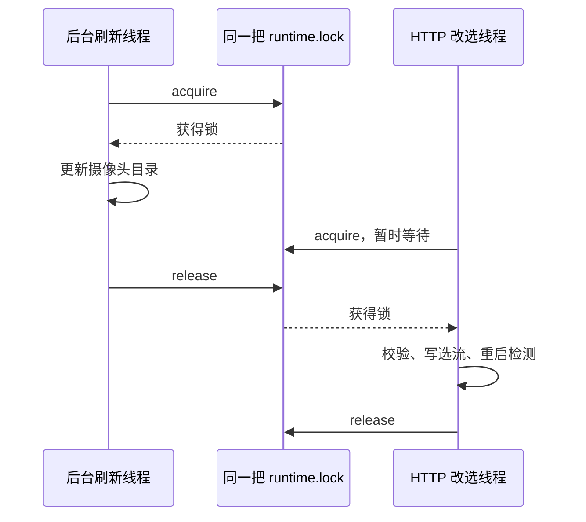
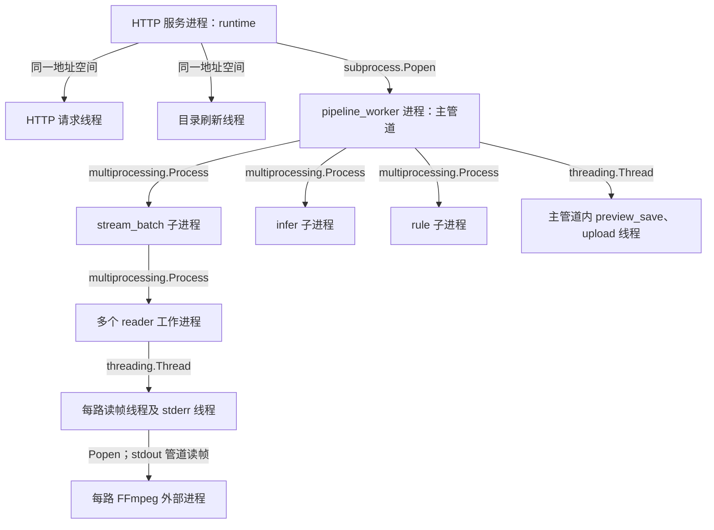

# 从视频检测项目理解进程、线程、锁与共享内存

学习日期：2026-10-29。代码基线：`feat/local-alarm-images` 分支、提交 `3d96386`。本文面向普通服务器版，讲解并发基础与当前调用关系。

本文只保留通用概念、原创教学示例和仓库相对源码位置，不包含业务视频、密钥、服务器地址或完整业务源码。源码位置用于在原项目对照阅读；行号随版本变化。标注“代码事实”的内容来自静态阅读，“待验证”的内容不能当成运行结果。

前置阅读：[Bash 多路视频推流脚本学习](../Linux与音视频/Bash多路视频推流脚本学习.md)。

## 1. 先纠正一个概念：锁不是进程调度器

正确语法是 `with self.lock:`，不是 `with.self.lock`。

- **操作系统调度**：决定哪个线程何时获得 CPU、在哪个核心运行。
- **应用任务编排**：程序决定启动哪些子进程、把数据发给谁、何时停止。
- **互斥锁**：多个执行者使用同一个资源时，让遵守同一把锁的操作依次进入。
- **进程间通信（IPC）**：让不同进程交换任务、结果或共享数据。

【代码事实】当前摄像头服务创建的是 `threading.Lock()`，主要协调同一 HTTP 服务进程内的线程。它没有锁住所有检测进程，也不负责分配 GPU。

依据：`project/camera_sys/server/service/runtime.py:57`，`CameraSysRuntime.__init__()`。

## 2. 学习顺序：先看懂，再谈优化

| 顺序 | 要学什么 | 学完应能回答 | 项目对照 |
|---|---|---|---|
| 1 | 类、实例、self、函数调用、异常 | 同一个 runtime 为什么能被多个请求使用？ | `server/app.py:create_app` |
| 2 | with、上下文管理器、try/finally | return 或异常时为什么仍会释放锁？ | `runtime.py:bootstrap` |
| 3 | 进程、线程、并发与并行、阻塞 | Thread.start、Process.start、Popen 有何区别？ | `process_host.py`、`thread_host.py` |
| 4 | 共享状态、竞态、Lock、RLock、死锁 | 哪段操作必须作为整体保护？ | `runtime.py:put_streams` |
| 5 | Queue、Event、生产者与消费者、背压 | 消费者慢了，发送方会阻塞还是丢数据？ | `session.py` |
| 6 | 进程地址空间、序列化、共享内存 | 为什么图像不直接全部塞进队列？ | `frame_batch_shm.py` |
| 7 | spawn、信号、join、资源生命周期 | 怎样有顺序地停止一棵进程树？ | `runner.py`、`pipeline_proc.py` |
| 8 | CPU/GIL/GPU、吞吐与延迟、观测工具 | 为什么增加线程未必提高检测路数？ | 结合线程栈和负荷实测 |

表中缩写路径的完整位置见后文源码索引。不必先学会操作系统内核调度算法，也不必先引入 asyncio；理解当前实际使用的同步工具即可。

## 3. with self.lock 到底做了什么

以下是教学示意，不是业务源码：

```python
with self.lock:
    update_state()
```

对于这里的锁，大致等价于：

```python
self.lock.acquire()
try:
    update_state()
finally:
    self.lock.release()
```

执行过程是：尝试拿锁 → 拿不到就等待 → 拿到后执行代码块 → 正常结束、return 或异常离开时释放锁。异常仍可能继续向外传播；释放锁不等于吞掉异常。强制杀死进程不属于正常的异常清理。

`self` 指当前实例，`self.lock` 是这个实例保存的锁。两个实例分别创建的锁互不协调；仅仅变量名相同没有用。锁也不会自动保护所有代码，其他访问者必须遵守相同的锁约定。

通用语义参考：[Python with 语句](https://docs.python.org/zh-cn/3.10/reference/compound_stmts.html#the-with-statement)、[threading：锁与上下文管理](https://docs.python.org/zh-cn/3.10/library/threading.html#using-locks-conditions-and-semaphores-in-the-with-statement)。

### 项目里是谁在竞争这把锁

【代码事实】`create_app()` 创建一个 runtime 并放入 `app.extensions`；路由从中取回同一个对象。HTTP 服务使用 `threaded=True`，还有一个后台目录刷新线程。

依据：

- `project/camera_sys/server/app.py:32`，`create_app()`：保存 runtime。
- `project/camera_sys/server/route/stream.py:14`，`_runtime()`：路由取回 runtime。
- `project/camera_sys/server/__main__.py:21`，`main()`：启用 HTTP 多线程。
- `project/camera_sys/server/app.py:51`，`start_catalog_refresh()`：启动后台线程。

| 方法 | 锁内主要工作 | 为什么需要协调 |
|---|---|---|
| `bootstrap()` | 检查运行状态、拉目录、写选流、准备结果目录、启动检测 | 避免启动与其他状态变更交错 |
| `put_streams()` | 校验摄像头、写配置、重启检测 | 避免两个改选请求交错写入与重启 |
| `refresh_once()` | 更新目录、检查已选摄像头 | 避免目录更新和改选互相穿插 |
| `cameras_payload()` | 读取目录 | 与受锁保护的目录更新协调 |
| `status()` | 读取选流、检查 pipeline 状态 | 避免在受保护的改选流程中途读取 |

依据：`project/camera_sys/server/service/runtime.py:61/94/117/132/145`，对应表中方法。

这不意味着状态是永久准确的：锁释放后子进程仍可能退出；返回对象也不因为曾在锁内读取就自动变成不可变对象。

### 用两个线程的时间线理解

假设后台刷新与用户改选恰好同时发生：



【合理推断】锁使这些操作不再交错，有利于维护状态一致性；代价是慢操作会拖长其他持锁方法的等待。代码把目录 HTTP 请求和 pipeline 重启放在锁内，因此平台响应慢或停进程慢时，相关状态接口可能一起等待。

依据：`runtime.py:107` 的 `put_streams()` → `_refresh_catalog_locked():150`、`_apply_locked():177`；`pipeline_proc.py:62` 的 `PipelineProcess.stop()`。具体等待时长需实测。

### 为什么内部函数叫 _xxx_locked

【代码事实】`_refresh_catalog_locked()`、`_apply_locked()` 等内部方法并没有再次获取锁；名字表达调用约定：外层应已经持锁。

当前用的是不可重入的 `threading.Lock`。同一线程持锁时再次尝试获取同一把锁，可能把自己永久挡住。不能随意在所有内部方法再补一层 `with self.lock`。

`RLock` 允许同一线程重复获取，但仍须配对释放，也不能自动解决多个锁顺序不一致造成的死锁。依据：`runtime.py:57/150/177`；[Lock 与 RLock 文档](https://docs.python.org/zh-cn/3.10/library/threading.html#lock-objects)。

## 4. 项目里不只有一种锁

| 位置 | 类型与用途 | 是否属于当前摄像头在线检测主链路 |
|---|---|---|
| `project/camera_sys/server/service/runtime.py:57`，`CameraSysRuntime.__init__` | 线程 Lock；保护控制状态和启停操作 | 是，HTTP 控制部分 |
| `project/camera_sys/tools/video_to_labelme/video_to_labelme.py:208`，入口中的工作进程装配 | `spawn` 上下文的 RLock；传给工作进程并交给 tqdm，协调进度条输出 | 否，离线工具 |
| `project/ship_line/core/upload/data_upload.py:200/223/280`，初始化、`submit` 和消费清理 | 线程 Lock；保护待上传集合，协调去重登记和移除 | 否，另一个业务模块 |

【代码事实】应先看锁的创建类型、共享对象和调用者，再判断它解决什么问题。进程间共享锁必须实际共享同一个同步对象，不能让每个进程各自 new 一把锁。

## 5. 进程与线程：看清“谁运行在哪里”

**进程**通常有独立的地址空间；**线程**属于某个进程，能访问该进程内共享对象。并发是多个任务交错推进，并行是多个任务同时执行。

【代码事实】摄像头后端的主要关系如下，省略库内部线程及其他辅助进程：



依据：

- `project/camera_sys/server/service/pipeline_proc.py:43`，`PipelineProcess.start()`。
- `core/pipeline/process_host.py:86`，`ProcessPipelineRegistry.start()`。
- `core/pipeline/thread_host.py:76`，`ThreadPipelineRegistry.start()`。
- `project/base/core/pipeline/stream_batch_sub_pipeline.py:53`，`StreamBatchSubPipeline.on_setup()`。
- `core/stream/backends/ffmpeg.py:168/259`，`FFmpegStreamWorker.start()/_start_proc()`。
- `core/stream/ffmpeg_reader.py:80`，`ffmpeg_stream_process_entry()`，另有退出监听与协调线程。

不是“每路摄像头一个独立模型进程”：当前配置把多路汇入一个 infer 子管道。reader 数量由分组配置决定，不能把摄像头路数直接当成总进程数。

### 三种启动方式的差别

| 写法 | 启动什么 | 本项目用途 |
|---|---|---|
| `threading.Thread(target=f).start()` | 同一进程内的新线程 | HTTP 后台刷新、读管道、保存和上传 |
| `multiprocessing.Process(target=f).start()` | 新 Python 工作进程 | 拉流、推理、规则子管道 |
| `subprocess.Popen(cmd)` | 外部程序或另一个 Python 解释器进程 | 启动 pipeline_worker 和 FFmpeg |
| 直接调用 `f()` | 当前线程继续执行 | 普通函数调用，不新增并发执行者 |

`start()` 或 `Popen()` 返回不表示模型已加载、首帧已到或所有子进程都准备好了。参考：[multiprocessing](https://docs.python.org/zh-cn/3.10/library/multiprocessing.html)、[subprocess](https://docs.python.org/zh-cn/3.10/library/subprocess.html)。

### spawn 与 GIL

【代码事实】`core/pipeline/runner.py:47` 的 `run_pipeline()` 尝试设置 `spawn`，注释说明是为了避免继承不能直接跨进程复用的 CUDA context。若启动方式已经设置，代码捕获 RuntimeError 后继续，因此不能只凭这一行断言任何调用环境都一定使用 spawn。

spawn 启动新的解释器，目标函数和传入参数需满足其导入、序列化要求。创建进程通常放在入口保护下，避免子解释器导入模块时重复创建进程。

对常规 CPython 3.10，GIL 限制同一进程内 Python 字节码的并行执行；I/O 等待和部分原生库计算仍可并发。多进程可以分开执行 Python 工作，但会增加通信和内存成本。**GIL 不保证“先检查、再更新、再启动”这一串业务操作的原子性，不能替代 runtime.lock。**

参考：[Python 3.10 threading 的 GIL 说明](https://docs.python.org/zh-cn/3.10/library/threading.html)、[进程启动方式](https://docs.python.org/zh-cn/3.10/library/multiprocessing.html#contexts-and-start-methods)。

## 6. Queue、Event 与共享内存分别负责什么

可以把这三者理解为：**Queue 传任务单，Event 传停止标志，共享内存放大幅图像。**

【代码事实】`PipelineSession.create_pair()` 为两端创建任务队列、结果队列和退出事件：

| 通信范围 | 队列 | 退出标志 | 数据传递特征 |
|---|---|---|---|
| 子进程之间 | multiprocessing.Queue | multiprocessing.Event | 普通消息需要序列化 |
| 同进程线程之间 | queue.Queue | threading.Event | 传对象引用，入队不自动深拷贝对象 |

依据：`core/pipeline/session.py:70/123`，`_make_queue_pair()/PipelineSession.create_pair()`。

Event 是可被检查或等待的标志，不是强制中断，也不是“设置一次就自动清空”的消息。目标若堵在其他不可返回的调用里，设置 Event 不一定立即结束它。依据：`session.py:198/203/213`，`is_shutdown/shutdown/recv_task`。

### 一帧怎样跨越进程边界

1. FFmpeg 输出原始像素，reader 线程从 stdout 管道读取。
2. reader 把完整暂存帧写入共享内存中该摄像头的 slot。
3. stream_batch 检测帧版本或连接状态变化，发送包含 SHM 名称、shape、序号的小消息。
4. 主管道通过队列把消息发给 infer。
5. infer 映射 SHM，复制到本轮 snapshot，再运行模型。
6. 检测结果通过主管道转给 rule；规则事件再由主管道交给告警线程。

【代码事实】像素主体与任务通知分开传递，减少了把整批图像经 multiprocessing.Queue 序列化的开销；仍然存在快照复制、GPU 数据传输等步骤，不能称为端到端零拷贝。

依据：

- `core/stream/backends/ffmpeg.py:222/286`，`_commit_scratch_to_shm()/_read_frame_into_scratch()`。
- `project/base/core/pipeline/stream_batch_sub_pipeline.py:117`，`on_run()`。
- `project/camera_sys/core/pipeline/main_pipeline.py:66/124/139`，`on_run()/_forward_rule_task()/_forward_upload()`。
- `project/base/core/pipeline/infer_sub_pipeline.py:168/204`，推理快照处理及 `_attach_shared_memory()`。

### 队列满了怎么办

| 当前模板中的队列 | 容量 | 满时行为 |
|---|---:|---|
| infer 输入／输出 | 1／1 | 丢旧消息，尽量处理新消息 |
| rule 输入 | 1 | 丢旧消息 |
| rule 输出 | 64 | 等待消费者腾位置 |
| preview_save 输入 | 1 | 丢旧任务 |
| upload 输入 | 256 | 等待消费者腾位置 |

依据：`project/camera_sys/configs/pipeline.yaml:12/24/75/90`；实现见 `core/pipeline/session.py:57/177`，`_put_drop_oldest()/PipelineSession._put()`。实际运行应核对生成后的 runtime 配置。

【合理推断】实时视频倾向保留新帧，事件输出倾向保留已生成的消息；但“不丢旧消息”不是持久化保证，进程崩溃仍可能丢队列内容。消费者长期变慢时，阻塞会向上游传递，这就是背压。

例：生产速度 30 项/秒、消费速度 20 项/秒，若两者一直维持，等待任务净增约 10 项/秒。加大队列只能推迟满队列的时间，不能提高消费能力，还会增加延迟。此为教学计算，不是项目实测值。

参考：[queue 官方文档](https://docs.python.org/zh-cn/3.10/library/queue.html)。

## 7. 共享内存快，但不自动保证数据正确

共享内存让多个进程映射同一块 CPU 内存。这里的“共享内存”不是 GPU 显存，也不是 CUDA kernel 内部的 shared memory。

【代码事实】`FrameBatchSharedMemory` 用 frame_version 标记写入：

- 写入前版本加一成为奇数。
- 复制像素后再加一成为偶数。
- 稳定读取尝试比较复制前后的版本，相同且为偶数才接受。

依据：`core/ipc/frame_batch_shm.py:151/197`，`write_slot()/_read_slot_stable()`。

这是类似 seqlock 的读取校验思路，不能仅凭名字推导出严格的跨平台原子性和内存屏障保证。当前还要特别注意：

1. 稳定读取最多重试 32 次，之后直接复制并告警，仍可能得到不完整帧。依据：`frame_batch_shm.py:14/204/217`。
2. infer 当前使用 `copy_from(..., unsafe=True)`，不检查源帧复制期间是否被改写。依据：`infer_sub_pipeline.py:170`、`frame_batch_shm.py:219`。
3. infer 有两块轮换 snapshot；双缓冲不是消费者已读完的确认协议。下游过慢时是否对应正确帧，需要验证。依据：`infer_sub_pipeline.py:82/168/233`。

【待验证】并发压力下是否出现帧撕裂、旧 snapshot 被覆盖、事件与画面错配。可在独立测试中写入带帧序号的合成图，故意放慢消费者，逐步核对消息序号与像素序号；不要把未经验证的版本变量实现直接当作通用无锁模板。

`close()` 关闭本进程映射，`unlink()` 请求移除共享内存对象；本项目把 unlink 责任限制在 owner。依据：`frame_batch_shm.py:272/283`。参考：[SharedMemory 官方文档](https://docs.python.org/zh-cn/3.10/library/multiprocessing.shared_memory.html)。

## 8. 启动、等待和关闭必须一起学

【代码事实】主要关闭层次如下：

| 层次 | 当前行为 | 不能误解为 |
|---|---|---|
| HTTP → pipeline_worker | 发 SIGTERM，等待 30 秒；超时 kill，再等待 5 秒 | 一次 kill 自动清理整棵进程树 |
| 主管道 → 子管道 | 设置退出 Event；逐个 join 5 秒，超时 terminate 后再等 2 秒 | 设置 Event 即已退出 |
| 主管道 → 线程管道 | 设置 Event，join 5 秒；仍存活时记警告 | join 超时会杀线程 |
| reader → FFmpeg | terminate，等待 2 秒；超时 kill 再等待 1 秒 | daemon 等于无须清理 |

依据：`pipeline_proc.py:62`，`PipelineProcess.stop()`；`core/pipeline/process_host.py:144`，`ProcessPipelineRegistry.stop()`；`core/pipeline/thread_host.py:135`，`ThreadPipelineRegistry.stop()`；`core/stream/backends/ffmpeg.py:229`，`FFmpegStreamWorker._terminate_proc()`。

`join()` 是等待结束，不是发出停止命令；`poll()` 检查子进程是否退出，不等价于模型健康检查。Python 普通线程没有安全的通用强杀接口，因此循环退出条件、网络超时和队列阻塞点都很重要。

【合理推断】`PipelineSession._put()` 在保留消息模式下使用没有超时的 `q.put(item)`；如果消费者停止，生产者可能持续堵住。依据：`core/pipeline/session.py:188`。需要故障测试确认具体关闭路径，不应声称现有代码已保证所有异常都能干净退出。

## 9. 一个可独立运行的最小练习

这个示例不拉流、不访问服务器，只练习“共享一个对象、同一把锁、等待线程完成”和“异常释放锁”。

```python
import threading

class Counter:
    def __init__(self):
        self.value = 0
        self.lock = threading.Lock()

    def add_many(self):
        for _ in range(10_000):
            with self.lock:
                self.value += 1

counter = Counter()
threads = [threading.Thread(target=counter.add_many) for _ in range(2)]
for thread in threads:
    thread.start()
for thread in threads:
    thread.join()
assert counter.value == 20_000

try:
    with counter.lock:
        raise ValueError("模拟锁内异常")
except ValueError:
    pass

assert counter.lock.acquire(timeout=1), "异常后锁应该已释放"
counter.lock.release()
print("检查通过")
```

练习方向：

1. 画出两个线程、一个 Counter、一个 Lock 的关系。
2. 改为两个 Counter，说明为什么两把锁不再协调同一个计数器。
3. 用容量为 1 的 queue.Queue 连接快生产者和慢消费者，分别观察阻塞与丢旧策略。
4. 用 Event 通知消费者退出，检查消费者是否还可能卡在无限等待的 get。
5. 最后才练习两个进程共享数组，并明确谁创建、谁写入、谁释放。

删除锁后的某次结果恰好正确，不能证明没有竞态。不要在持锁后等待一个必须由其他线程获取同一把锁才能推进的 Barrier/Event。

## 10. 在现有服务器上怎样观察

以下是学习时手动执行的只读观察命令；本笔记同步过程没有执行它们。先用进程列表确认目标，避免采集无关服务。

```bash
# 查看 Python 与 FFmpeg 的进程、父进程关系
ps -eo pid,ppid,nlwp,stat,comm,args --forest | rg 'python|ffmpeg'

# 将示例数字换为实际的 Python 进程 PID
TARGET_PID=12345
pstree -pt "$TARGET_PID"
ps -L -p "$TARGET_PID" -o pid,tid,pcpu,stat,comm
top -H -p "$TARGET_PID"

# 安装 py-spy 且具备附加权限时，观察 Python 栈
py-spy dump --pid "$TARGET_PID"
py-spy top --pid "$TARGET_PID"

# 如果系统安装了 sysstat，观察 CPU 与上下文切换
pidstat -u -w -p "$TARGET_PID" 1
```

先区分卡在锁、队列、网络、子进程等待还是计算。一次栈快照不能证明死锁；需要连续采样并观察状态是否推进。进程参数、堆栈可能包含环境信息，分享前应检查。

【待验证】想测锁竞争时，应在单独测试分支记录“开始 acquire → 拿到锁 → 释放锁”的单调时钟时间，分别统计等待与持锁时长；不能只测整个 HTTP 请求后就把慢归因于锁。

工具说明：[py-spy 官方仓库](https://github.com/benfred/py-spy)。

## 11. 推荐资源：按当前问题读对应章节

| 资源 | 建议阅读范围 | 目的 |
|---|---|---|
| [Python with 语句](https://docs.python.org/zh-cn/3.10/reference/compound_stmts.html#the-with-statement) | with 的进入、退出、异常语义 | 理解自动清理 |
| [threading 中文文档](https://docs.python.org/zh-cn/3.10/library/threading.html) | Thread、Lock、RLock、Event、join | 看懂 runtime 与后台线程 |
| [queue 中文文档](https://docs.python.org/zh-cn/3.10/library/queue.html) | put/get、阻塞、Full/Empty | 理解生产者与消费者 |
| [multiprocessing 中文文档](https://docs.python.org/zh-cn/3.10/library/multiprocessing.html) | Process、启动方式、Queue、同步、编程指导 | 看懂子管道进程 |
| [subprocess 中文文档](https://docs.python.org/zh-cn/3.10/library/subprocess.html) | Popen、PIPE、poll/wait、terminate/kill | 看懂 Python 如何管理 FFmpeg |
| [SharedMemory 中文文档](https://docs.python.org/zh-cn/3.10/library/multiprocessing.shared_memory.html) | create、attach、NumPy 示例、close/unlink | 理解图像跨进程传递 |
| [OSTEP 免费教材](https://pages.cs.wisc.edu/~remzi/OSTEP/) | Processes、CPU Scheduling、Concurrency、Locks、Condition Variables、Concurrency Bugs | 补操作系统原理，不必从头通读 |
| [py-spy](https://github.com/benfred/py-spy) | dump、top | 将调用关系与实际线程栈对照 |

Python 文档选用与项目背景一致的 3.10 版本；资源链接于学习日期核查。教材原理用于解释概念，不替代本项目运行验证。

## 12. 阅读源码时固定问这六个问题

1. 谁创建这个对象？它属于哪个进程？
2. 哪些线程或进程能访问它？共享的是对象还是序列化后的副本？
3. 谁写、谁读？是否有共同遵守的锁或消息协议？
4. 等待发生在哪里？有无超时？队列满了怎么办？
5. 什么时候认为数据完整？消息是否还对应同一帧？
6. 谁发停止信号，谁等待退出，谁负责最终释放？

建议阅读链：

`server/__main__.py` → `server/app.py` → `server/service/runtime.py` → `server/service/pipeline_proc.py` → `core/pipeline/runner.py` → `core/pipeline/base.py` → `process_host.py/thread_host.py` → `session.py` → `stream_batch_sub_pipeline.py` → `frame_batch_shm.py` → `infer_sub_pipeline.py`。

其中 server 路径均位于 `project/camera_sys/`，stream_batch 与 infer 文件位于 `project/base/core/pipeline/`。

自测：为什么 runtime.lock 不会让所有摄像头一条条推理？因为这把锁保护的是 HTTP 进程里的控制状态，检测在其他进程中通过队列和共享内存推进。它保护正确性；吞吐能力仍由流水线各阶段的处理速度与资源决定。

## 验证边界

本文完成了静态源码核对和独立锁示例检查。未启动业务检测，未做锁竞争、故障退出、共享内存一致性或长期压力测试；上述风险是需要验证的代码行为，不代表已经复现故障。
