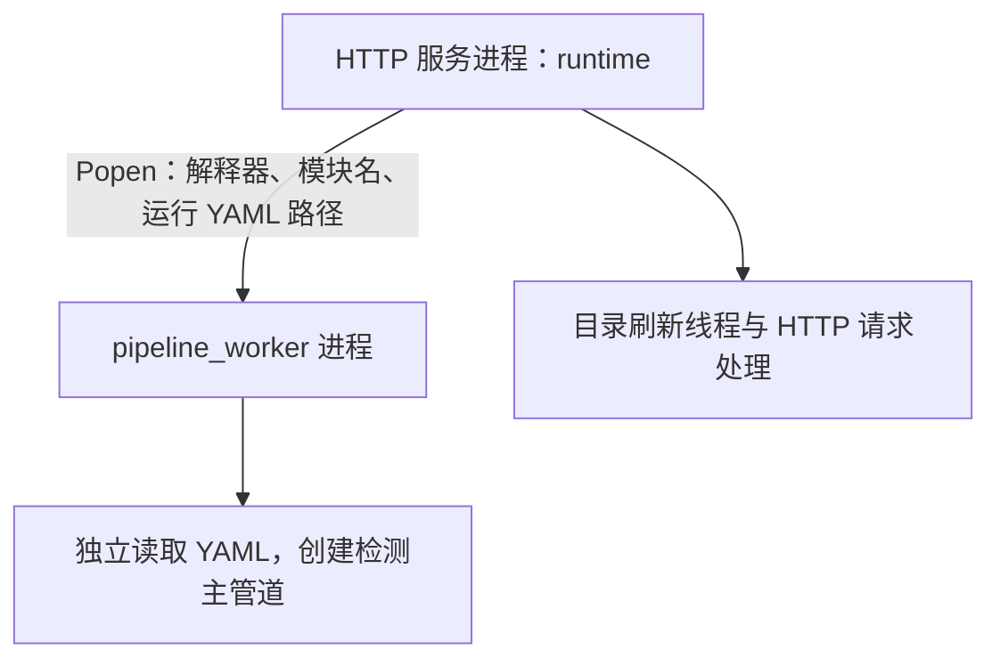
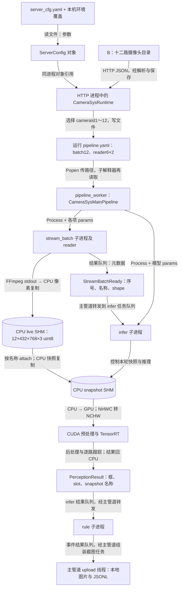

# 十二路配置如何变成进程、共享内存与队列消息

学习日期：2026-10-29。代码基线：`feat/local-alarm-images` 分支、提交 `94f16dc`。适用于普通服务器版本。

前置阅读：[从视频检测项目理解进程、线程、锁与共享内存](从视频检测项目理解进程线程锁与共享内存.md)。推流脚本基础见 [Bash 多路视频推流脚本学习](../Linux与音视频/Bash多路视频推流脚本学习.md)。

本文沿实际调用顺序，解释十二路摄像头配置如何变成工作进程，以及一帧画面如何跨进程抵达检测和告警。参数来自本次读取的代码、配置和磁盘缓存；磁盘缓存不证明服务此刻正在运行。本文未启动服务。

示例使用仓库相对路径和本机回环地址，不包含服务密钥、真实业务视频、私人服务器地址或完整业务源码。PID、共享内存名称、检测框和告警文件名由运行时产生，本文不编造观测值。下文代码为省略无关字段后的教学表达。

## 1. 先区分三种传递

| 场景 | 实际传递什么 | 理解要点 |
|---|---|---|
| 同一进程的函数调用 | Python 对象引用 | create_app(cfg) 中的 cfg 是已有对象 |
| 启动 pipeline_worker | 命令行参数中的 YAML 文件路径 | 新解释器重新读文件，不直接持有 HTTP 进程里的 runtime |
| 检测子管道之间 | 队列中的消息、共享内存中的像素 | 任务通知和大幅图像分开传递 |

“文件 A 调用文件 B”更准确的说法是：某个函数调用另一个模块中的函数，或者启动一个进程，让新进程执行另一个入口。文件名本身不会执行调度。

## 2. 十二路测试的具体值

A 将六个视频各发布两路，共十二个独立的 RTMP 流；B 提供摄像头目录和查看页面；C 根据 B 的目录启动检测。

| 参数 | 本次测试使用的值 |
|---|---|
| B 的目录服务地址 | `http://127.0.0.1:2670` |
| C 的监听地址 | `0.0.0.0:2674` |
| 目录请求超时 | 10 秒 |
| 目录正常刷新间隔 | 3600 秒 |
| 未启动管道的后台检查间隔 | 当前配置下 30 秒 |
| 服务选流上限 | 16 |
| 本次选中的 cameraId | 1～12 |
| 每个 reader 负责路数 | 2 |
| 本次 reader 进程数量 | 6 |
| 本次 batch_size | 12 |
| 解码输出 | RGB、768×432、uint8，目标 18 FPS |
| 检测器输入尺寸 | 768×768 |
| 告警模式 | local_only |

配置来源：

- `project/camera_sys/configs/server_cfg.yaml`：服务参数。
- `project/camera_sys/tools/mock_platform/config.yaml`：B 的路数和流地址模板。
- `project/camera_sys/configs/pipeline.yaml`：管道模板。
- `runtime/camera_sys/pipeline.yaml`：本次生成的运行配置。
- `project/camera_sys/configs/camera_sys_road_obj_det.yaml`：检测器参数。

服务上限 16、模型最大 batch 32、本次选择 12，是不同概念，均不直接保证实时处理能力。

## 3. 第一步：server/__main__.py 加载 cfg

C 按本机文档启动时，给启动脚本传入：

```bash
CAMERA_SYS_PLATFORM_BASE_URL=http://127.0.0.1:2670 \
CAMERA_SYS_ALARM_MODE=local_only \
bash project/camera_sys/tools/server_start.sh
```

启动脚本最终使用项目虚拟环境解释器执行：

```bash
python -m project.camera_sys.server
```

包入口 `server/__main__.py` 调用 `main()`，首先配置日志，再执行：

```python
cfg = load_server_config()
```

`load_server_config()` 读取 YAML、应用环境覆盖并校验字段，返回一个 ServerConfig 对象。理解成：

```text
cfg.host                     = "0.0.0.0"
cfg.port                     = 2674
cfg.platform_base_url        = "http://127.0.0.1:2670"
cfg.platform_timeout         = 10
cfg.refresh_interval_seconds = 3600
cfg.max_stream_count         = 16
cfg.pack_streams_per_worker  = 2
cfg.alarm_mode               = "local_only"
cfg.pipeline_template        = <仓库>/project/camera_sys/configs/pipeline.yaml
cfg.pipeline_yaml            = <仓库>/runtime/camera_sys/pipeline.yaml
```

本机环境变量只覆盖此次启动所用的配置对象，正式平台的 YAML 声明仍然保留。这里只加载参数，尚未请求目录或启动检测。

依据：`project/camera_sys/server/__main__.py:14`，`main()`；`project/camera_sys/server/config.py:44`，`load_server_config()`。

## 4. 第二步：app.py 将 cfg 交给 CameraSysRuntime

入口调用：

```python
app = create_app(cfg)
```

在 `create_app()` 中，由于 cfg 已传入而 runtime 未传入，使用现有 cfg，并创建：

```python
runtime = CameraSysRuntime(cfg)
```

构造函数按配置准备：

| runtime 成员 | 本次保存的信息 | 此时是否已经执行实际工作 |
|---|---|---|
| cfg | 上一步配置对象 | 已加载配置 |
| client | 目录服务地址、密钥、10 秒超时 | 尚未请求平台 |
| catalog_store | runtime/camera_sys/cameras.json 路径 | 尚未读取或保存目录 |
| pipeline | 运行 YAML 路径、工作目录，_proc=None | 尚未创建检测进程 |
| lock | 一把 threading.Lock | 尚未进入持锁代码块 |
| _catalog | None | 尚未装入摄像头目录 |
| _results_prepared | False | 尚未准备本轮结果归档 |

`create_app()` 再创建 Flask、注册鉴权和路由，并保存：

```python
app.extensions["camera_sys_runtime"] = runtime
```

返回入口后：

```python
runtime = app.extensions["camera_sys_runtime"]
```

取回的是同一个实例，不会再次初始化。此阶段所有这些对象都属于 HTTP 服务进程。

依据：`project/camera_sys/server/app.py:19`，`create_app()`；`project/camera_sys/server/service/runtime.py:30`，`CameraSysRuntime.__init__()`；`project/camera_sys/server/service/pipeline_proc.py:22`，`PipelineProcess.__init__()`。

## 5. 第三步：bootstrap 经 HTTP 取得十二路目录

HTTP 入口先绑定服务端口，然后调用：

```python
runtime.bootstrap()
```

第一层逻辑：

```text
取得 runtime.lock
  → 检查 pipeline 是否已运行
  → 未运行时，获取最新摄像头目录
```

调用链：

```text
CameraSysRuntime.bootstrap()
  → _refresh_catalog_locked()
    → CatalogStore.refresh(client, allow_cached=False)
      → PlatformClient.fetch_cameras()
        → requests.get(...)
```

本机请求是：

```http
GET http://127.0.0.1:2670/api/model/v1/cameras
X-Api-Key: <配置中的密钥>
```

B 根据 camera_count=12 生成目录。以第一路的核心字段为例：

```json
{
  "cameraId": 1,
  "cameraCode": "CAM_001",
  "rtspUrl": "rtmp://127.0.0.1:1935/camera_sys/live_1",
  "streamMode": "full_fps",
  "frameInterval": null
}
```

第十二路则是 cameraId=12、CAM_012 和 live_12。字段名 rtspUrl 是平台契约名称，本机字段值实际使用 RTMP。

响应 JSON 被解析为 CameraCatalog，保存为 cameras.json，并赋给 runtime._catalog：

```text
HTTP JSON
  → Python 摄像头目录对象
  → 本地目录缓存 JSON
```

最新目录获取失败时，这个 bootstrap 不使用旧缓存 URL 启动检测；会保留 HTTP 服务，等待后续重试。

依据：`runtime.py:61/150`，`bootstrap()/_refresh_catalog_locked()`；完整路径为 `project/camera_sys/server/service/runtime.py`。目录读取见 `project/camera_sys/server/service/catalog.py:74`，`CatalogStore.refresh()`；HTTP 见 `project/camera_sys/adapter/platform.py:171`，`fetch_cameras()`。

## 6. 第四步：selection.py 将目录变成运行任务单

当前磁盘中的 selected.json：

```json
{"cameraIds": [1,2,3,4,5,6,7,8,9,10,11,12]}
```

bootstrap 校验这些 ID 后调用：

```python
self._apply_locked(selected, catalog, restart=False)
```

它按 cameraId 的顺序取得 URL，交给 `apply_stream_selection()`：

```text
camera_ids = [1, 2, ..., 12]
urls       = [live_1 对应 URL, live_2 对应 URL, ..., live_12 对应 URL]
pack       = 2
```

计算：

```text
count = 12
worker_count = 12 // 2 = 6
streams_per_worker = 2
```

随后读取模板，写入 `runtime/camera_sys/pipeline.yaml`，关键变化是：

```yaml
main_pipeline:
  params:
    camera_ids: [1, 2, 3, 4, 5, 6, 7, 8, 9, 10, 11, 12]

sub_pipelines:
- name: stream_batch
  params:
    batch_size: 12
    worker_count: 6
    streams_per_worker: 2
    stream:
      stream_urls:
      - rtmp://127.0.0.1:1935/camera_sys/live_1
      # 省略 live_2 到 live_11
      - rtmp://127.0.0.1:1935/camera_sys/live_12
- name: infer
  params:
    batch_size: 12
```

上面为省略展示，不是可直接运行的完整 YAML。模板中的 batch_size=16 不决定本次运行路数，生成结果中的 12 才对应本次选择。

位置关系固定为：

| 数组 slot | cameraId | 源流 |
|---:|---:|---|
| 0 | 1 | live_1 |
| 1 | 2 | live_2 |
| … | … | … |
| 11 | 12 | live_12 |

slot 是批量数组位置，从 0 开始；cameraId 是业务编号。它们不能互换。

依据：`project/camera_sys/server/service/runtime.py:177`，`_apply_locked()`；`project/camera_sys/server/service/selection.py:156/192`，`pack_workers()/apply_stream_selection()`。

## 7. 第五步：PipelineProcess.start 创建检测主管道进程

bootstrap 完成配置和本轮结果准备后：

```python
self.pipeline.start()
```

本机 local_only 模式下，首次准备检测会按归档规则备份上一轮结果；归档完成不表示模型初始化一定成功。

`PipelineProcess.start()` 使用 Popen，命令等价于：

```bash
python -m project.camera_sys.server.pipeline_worker runtime/camera_sys/pipeline.yaml
```

实际代码传递绝对配置路径，工作目录设为仓库根目录，解释器使用 sys.executable。这里的命令为了学习采用相对路径表达。

这是从 HTTP 服务进入独立检测主管道进程的边界：



父进程不会把整个 runtime 实例直接交给新解释器。Popen 返回也不代表模型已经加载完成。

HTTP 入口接着启动目录刷新线程，再进入 serve_forever。当前每 30 秒检查一次未启动管道，正常目录刷新周期为 3600 秒。

依据：`project/camera_sys/server/service/pipeline_proc.py:43`，`PipelineProcess.start()`；`project/camera_sys/server/__main__.py:21`，`main()`；`project/camera_sys/server/app.py:51`，`start_catalog_refresh()`。

## 8. 第六步：pipeline_worker → runner → BaseMainPipeline

新进程入口从 sys.argv[1] 取得配置路径：

```python
run_pipeline(Path(sys.argv[1]))
```

runner 读取 YAML 后获得：

```text
module     = project.camera_sys.core.pipeline.main_pipeline
class_name = CameraSysMainPipeline
```

于是动态导入并实例化该类，再调用 run。YAML 字符串在这里决定具体执行哪个业务类。

CameraSysMainPipeline 继承 BaseMainPipeline。初始化创建进程注册表、线程注册表和停止事件；run 中再执行：

```text
setup()
  → 业务 on_setup()
  → 启动 enabled 子管道进程
  → 启动 enabled 线程管道
on_run()
  → 业务主管道循环
finally
  → shutdown()
```

runner 尝试选择 spawn，并注册 SIGTERM/SIGINT 处理。若进程启动方式已经设置，代码捕获 RuntimeError 后继续，不能只凭这一行断言任何外部调用环境都一定使用 spawn。

依据：`project/camera_sys/server/pipeline_worker.py:11`，`main()`；`core/pipeline/runner.py:44`，`run_pipeline()`；`core/pipeline/base.py:124/143/177`，`BaseMainPipeline.__init__()/setup()/run()`。

## 9. 第七步：process_host/thread_host 按配置创建执行者

当前运行配置装配成：

| 名称 | 执行方式 | 类 |
|---|---|---|
| stream_batch | 子进程 sub-stream_batch | StreamBatchSubPipeline |
| infer | 子进程 sub-infer | InferSubPipeline |
| rule | 子进程 sub-rule | RuleSubPipeline |
| preview_save | 主管道中的线程 | PreviewSaveThreadPipeline |
| upload | 主管道中的线程 | CameraAlarmThreadPipeline |

进程注册表对每项先建 Session，再创建 multiprocessing.Process。子进程入口动态实例化对应类，传入该项 params，执行 on_setup 后进入运行循环。

因此 stream_batch 收到十二路 URL、batch=12 和 6×2 拓扑；infer 收到模型名 det、检测器 YAML 路径与 interval=0。两者不会把整份 params 当成相同业务解释。

线程注册表采用相似步骤，但使用 threading.Thread 和线程后端 Session。

依据：`core/pipeline/process_host.py:22/86`，`_run_sub_pipeline()/ProcessPipelineRegistry.start()`；`core/pipeline/thread_host.py:76`，`ThreadPipelineRegistry.start()`。

## 10. 第八步：Session 建立队列和退出标志

以 infer 为例：

```yaml
task_queue_size: 1
task_drop_oldest: true
result_queue_size: 1
result_drop_oldest: true
```

create_pair 创建同一组底层任务队列、结果队列和退出 Event，再包装为两端句柄：

```text
主管道 main_session.send_task(task)
    ↓ multiprocessing 任务队列，容量 1
infer sub_session.recv_task()
    ↓ 执行业务处理
infer sub_session.send_result(result)
    ↓ multiprocessing 结果队列，容量 1
主管道 main_session.recv_result()
```

队列满时丢旧消息后重试。线程管道使用 queue.Queue 和 threading.Event，不自动深拷贝任务对象。

Event 用于通知退出，不是强制中断。需要各循环主动检查，阻塞调用也需要考虑超时。

依据：`core/pipeline/session.py:70/123/177/203`，`_make_queue_pair()/create_pair()/_put()/shutdown()`。

## 11. 第九步：stream_batch 创建共享内存和六个 reader

根据 Scale 配置，创建：

```python
FrameBatchSharedMemory.create(12, 432, 768, 3)
```

像素数组：

```text
shape = (12, 432, 768, 3)  # N,H,W,C
dtype = uint8
设备  = CPU 共享内存
```

一批像素占 `12 × 432 × 768 × 3 = 11,943,936` 字节，此外还有版本、在线状态、重连代数等字段。

六个 reader 的分工：

| reader 编号 | slot | cameraId |
|---:|---|---|
| 0 | 0、1 | 1、2 |
| 1 | 2、3 | 3、4 |
| 2 | 4、5 | 5、6 |
| 3 | 6、7 | 7、8 |
| 4 | 8、9 | 9、10 |
| 5 | 10、11 | 11、12 |

reader 内每路读帧线程管理自己的 FFmpeg 子进程，从相应 RTMP URL 拉流。当前配置为 CUDA/h264_cuvid 解码，输出 RGB、768×432、目标 18 FPS，经 stdout 管道读入完整帧暂存区，再写 slot。

实际路径：

```text
stream_batch_sub_pipeline.py
  → ffmpeg_reader.py：工作进程入口
    → backends/ffmpeg.py：每路读帧线程、FFmpeg 子进程
      → frame_batch_shm.py：write_slot()
```

每路只负责自己的像素位置。shared memory 同时保存 frame_version、connected、reconnect_epoch，供消费者检查状态。

依据：`project/base/core/pipeline/stream_batch_sub_pipeline.py:53`，`on_setup()`；`core/stream/ffmpeg_reader.py:53`，`ffmpeg_stream_process_entry()`；`core/stream/backends/ffmpeg.py:168/222/259`，`start()/_commit_scratch_to_shm()/_start_proc()`；`core/ipc/frame_batch_shm.py:151`，`write_slot()`。

## 12. 第十步：StreamBatchReady 通知主管道，再转给 infer

stream_batch 每次轮询间隔配置为 0.005 秒。有帧版本或连接状态变化时，发送：

```python
StreamBatchReady(
    batch_seq=递增的通知序号,
    shm_name=运行时生成的共享内存名称,
    shape=(12, 432, 768, 3),
)
```

这是对象字段示意；序号和名称需运行时观测。通知本身不携带十二张图，也不保证所有 slot 同时换帧。

主管道的 CameraSysMainPipeline.on_run 收集 stream_batch 结果，取最新一条，发给 infer Session：

```text
stream_batch
  → stream_batch 结果队列
  → 主管道 main_pipeline.py
  → infer 任务队列
  → infer
```

因此最初的文件阅读链中，还需要补上业务主管道 `main_pipeline.py`：它负责子管道之间的消息转发。

依据：`project/base/core/pipeline/stream_batch_sub_pipeline.py:117`，`on_run()`；`project/camera_sys/core/pipeline/main_pipeline.py:66`，`on_run()`；`core/ipc/messages.py:9`，`StreamBatchReady`。

## 13. 第十一步：infer 收消息、映射 SHM、调用 det 模型

infer 使用基类任务循环从 Session 收消息，交给 _process。_process 先检查类型，再按 shm_name 和 shape 映射 live SHM，并建立两块轮换 snapshot。

处理某轮任务时：

```text
live SHM
  → copy_from(..., unsafe=True)
  → 本轮 snapshot SHM
  → unsafe_read_batch() 取得 NumPy 视图
```

此时 batch.shape=(12,432,768,3)，dtype=uint8。active 是十二路在线状态，实际 true/false 由运行时读取。

on_setup 先前已加载：

```yaml
name: det
detector_cfg: project/camera_sys/configs/camera_sys_road_obj_det.yaml
interval: 0
```

该 YAML 指向 weights/camera_sys/road_obj_det。本机外部 infer_cfg 声明 format=engine、imgsz=[768,768]、dynamic=true、batch=32、profile_batch=[1,16,32]。这些是资产配置声明，真实 TensorRT tensor/profile 是否匹配仍需加载核对。

模型调用：

```python
per_slot = runtime.detector.infer_batch(batch, active)
```

在 infer_sub_pipeline 中，这里的 runtime 是单个模型运行记录，**不是 HTTP 进程的 CameraSysRuntime**；同名变量要结合所在类和作用域理解。

检测器内部的数据变化：

```text
RGB uint8 NHWC：(12,432,768,3)
  → 主机到设备传输、CUDA LetterBox、归一化、通道排列
模型输入 NCHW：(12,3,768,768)
  → TensorRT
  → 后处理、坐标还原
  → 每个在线 slot 更新自己的 ByteTrack
  → 十二路按 slot 对齐的结果
```

interval=0 表示不额外按模型时间间隔限频，不表示每个原始视频帧都一定检测。任务队列丢旧和共享内存覆盖仍然存在；离线路也不能简单推导为计算时自动缩小 batch。

依据：`core/pipeline/base.py:89`，`BaseSubPipeline.on_run()`；`project/base/core/pipeline/infer_sub_pipeline.py:113/144/204`，`on_setup()/_process()/_attach_shared_memory()`；`core/deeplearning/detectors/yolo_detector.py:58/114`，`_run_inference()/infer_batch()`。

## 14. 第十二步：PerceptionResult 返回，接上规则与保存

infer 生成的结果结构：

```text
PerceptionResult
  batch_seq：沿用输入通知序号
  shm_name：本轮 snapshot 名称
  shape：(12,432,768,3)
  slots：slot 0～11
    connected：该路在线状态
    detections：
      model="det"
      detections=该路检测/跟踪结果
```

没有使用示例检测框冒充实测结果。这里的 shm_name 已从 live 名称变成本轮 snapshot 名称。

随后：

```text
infer 结果队列
  → 主管道
  → rule 任务队列
  → 行人／摩托车／异常停车规则
  → RuleEvent
  → 主管道按 slot 找 cameraId 并拷贝告警截图
  → upload 线程
  → 本地 JPEG、日期 JSONL
```

例如 slot=0 映射 cameraId=1，slot=11 映射 cameraId=12。当前规则声明为：行人最近 5 次中至少 4 次且本次命中；摩托车 10 中 6 且本次命中；两者各有 60 秒冷却；异常停车按 20 秒和 30 像素判定。窗口是规则评估次数，不应直接称为不同原始视频帧。

当前本地保存位置：

```text
~/aicamera/abnormal_files/<cameraId>/年/月/日/时间戳.jpg
runtime/camera_sys/alarms/YYYY-MM-DD.jsonl
```

B 再读取这些文件供网页查询。当前 local_only 不执行远程告警请求。

依据：`project/base/core/ipc/messages.py:37/46`，`SlotPerception/PerceptionResult`；`project/camera_sys/core/pipeline/main_pipeline.py:124/139/160`，`_forward_rule_task()/_forward_upload()/_copy_alarm_frame()`；`project/camera_sys/core/upload/alarm_handler.py:79/176/196`，`run()/_save_local_record()/_save_frame()`；规则参数见 pipeline.yaml 的 rule.params。

## 15. 用一张图串起两条数据路径



图中的两条路径需要一起看：**像素主要放在共享内存，队列主要传定位信息、检测结果和事件。** 告警线程任务携带主管道已拷贝的截图；不能把所有队列都理解为只传三个字符串字段。

## 16. 为什么这样设计，以及边界在哪里

| 设计 | 用途 | 代价或待验证项 |
|---|---|---|
| HTTP 与检测分进程 | 控制服务和检测生命周期分开 | 启动返回不表示模型就绪 |
| 配置驱动动态导入 | 共用框架装配不同业务类 | 模块名、类名、参数必须匹配 |
| 大图 SHM、小消息 Queue | 减少整批图像反复序列化 | 仍有 CPU 复制和 GPU 传输 |
| 小队列丢旧 | 限制历史积压，优先新通知 | 不保证每帧都处理 |
| 事件队列不丢旧 | 避免主动覆盖已生成事件 | 队列满会阻塞，崩溃仍可能丢失 |
| 两块 snapshot 轮换 | 减少下游直接读取 live 的覆盖干扰 | 不等于消费者已完成确认协议 |

当前 infer 的 unsafe 源复制不检查源帧是否同时被写入；稳定读取路径也有重试后降级复制。双 snapshot 可能在慢消费者读完前被重新使用，RuleEvent 与截图的关联也需要独立核对。不能把这段实现当作已验证的严格无锁协议或端到端零拷贝设计。

依据：`core/ipc/frame_batch_shm.py:197/219/264`，`_read_slot_stable()/copy_from()/unsafe_read_batch()`；`project/base/core/pipeline/infer_sub_pipeline.py:168/233`；`project/camera_sys/core/pipeline/main_pipeline.py:160`，`_copy_alarm_frame()`。

## 17. 自测与迁移练习

1. 为什么 cfg 可以直接传给 create_app，但不能认为 HTTP runtime 直接传进了 pipeline_worker？
2. 模板 batch=16、本次 batch=12、模型最大 batch=32，各自控制什么？
3. slot=7 对应哪个 cameraId？答案是 cameraId=8，前提是本次选流顺序未改变。
4. 如果只修改 mock 的 camera_count，为什么 A 的推流映射、服务选流和模型能力仍需一起核对？
5. 一路产生新帧，为什么通知的 shape 仍然是十二路？
6. 一个通知已在队列里等待时，SHM 像素是否仍可能被更新？
7. 消费者变慢时，infer 丢旧消息和 upload 阻塞分别会带来什么效果？

迁移练习：在独立教学脚本中，先用两个进程和 Queue 传递小任务，再让一个进程创建 SharedMemory，另一个按名称映射；消息只包含名称、形状和序号。规定单写者，并明确谁 close、谁 unlink。最后再加入受控的覆盖压力，理解“消息序号”与“读到的像素”为什么需要一致性协议。

本笔记仅做静态源码和现有配置核对，未运行十二路检测、未加载 engine 或验证真实帧身份。后续实测应重点核对模型就绪、不同帧处理率及事件与截图对应关系。
