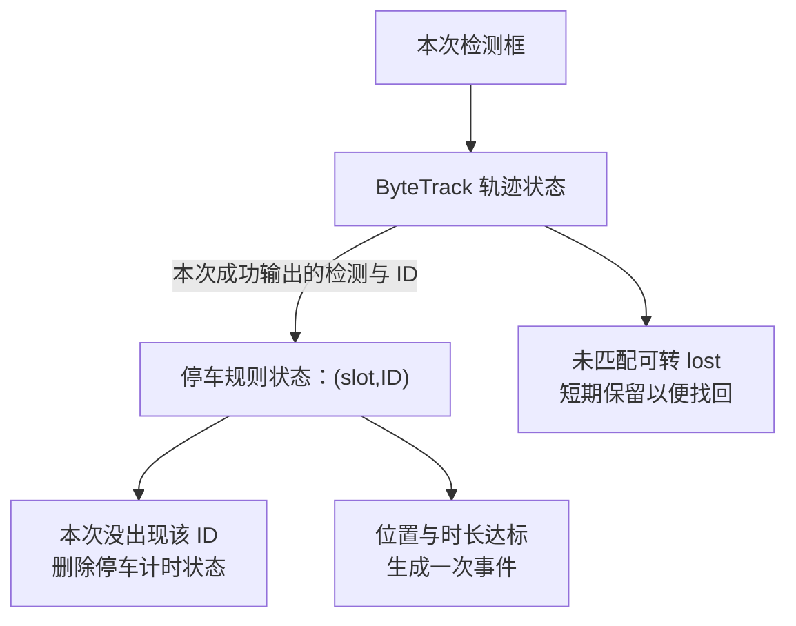

# ByteTrack 如何服务异常停车规则

学习日期：2026-10-29。项目基线：`feat/local-alarm-images`，提交 `94f16dc`；本机安装并核对的跟踪依赖为 `supervision==0.29.1`。

关联阅读：[流水线为什么要并发](../Python并发/流水线为什么要并发.md)、[十二路配置到进程与消息](../Python并发/十二路配置如何变成进程共享内存与队列消息.md)。

本文依据项目封装、规则源码和本机依赖源码；教学框坐标、ID 与时间线不是实测结果。只保留通用概念与仓库相对源码位置，不含服务密钥、私人服务器信息或完整业务源码。

## 1. 检测、跟踪和停车规则分别回答什么

| 环节 | 回答的问题 | 典型输出 |
|---|---|---|
| 目标检测 | 这一张画面哪里有车？ | 框、类别、置信度 |
| 多目标跟踪 | 前后几次看到的框，哪些属于同一目标？ | 在检测结果上补 tracker_id |
| 异常停车规则 | 同一路、同一个 ID 是否在参考位置附近持续足够久？ | vehicle_stopped 事件 |

框在相邻画面中位置接近，不能自动证明同一辆车；跟踪就是建立有状态的关联。ID 也不是车牌或永久身份。

## 2. 项目里的真实调用链

```text
InferSubPipeline._process()
  → YoloDetector.infer_batch()
    → 模型预处理、TensorRT、后处理
    → 按 slot 选择 ByteTracker
    → ByteTracker.update()
      → supervision.ByteTrack.update_with_detections()
  → PerceptionResult
  → 主管道转发
  → RuleSubPipeline
    → VehicleStopRule.evaluate()
      → _collect_seen()
      → _update_track()
      → _drop_unseen()
```

跟踪在 infer 子进程内完成，当前主要是 CPU 数组和匹配运算，没有单独的跟踪进程。项目按 engine 最大 batch 预建跟踪器，本次十二路使用对应 slot；重连代数变化时，infer 会重置对应 slot 的 tracker。

依据：

- `project/base/core/pipeline/infer_sub_pipeline.py:144/153`，`_process()`。
- `core/deeplearning/detectors/yolo_detector.py:40/114/155`，构造函数与 `infer_batch()`。
- `core/deeplearning/trackers/byte_track.py:113/141`，`ByteTracker/update()`。
- `project/camera_sys/core/rule/vehicle_stop.py:40/88/128/184`，对应规则方法。

## 3. 每路独立跟踪，ID 的作用范围要看清

十二路位置与摄像头编号映射：

```text
slot0 → cameraId1 → 第一路 tracker
slot1 → cameraId2 → 第二路 tracker
...
slot11 → cameraId12 → 第十二路 tracker
```

不同 tracker 可产生同样的数字 ID，因此停车状态使用：

```text
key = (slot, tracker_id)
```

教学例子：cameraId1 的 ID17 与 cameraId2 的 ID17 是两份状态。当前没有跨摄像头身份关联或车牌级身份保持。

依据：`yolo_detector.py:155`，`infer_batch()`；完整路径为 `core/deeplearning/detectors/yolo_detector.py`。规则键见 `project/camera_sys/core/rule/vehicle_stop.py:150`，`_update_track()`。

## 4. ByteTrack 原理：先预测，再关联，再维护轨迹

### 4.1 卡尔曼滤波预测位置

跟踪器保存运动状态和不确定性，根据历史状态预测本次目标框可能在哪里，再用本次检测修正预测。常见状态表示：

```text
[x, y, a, h, vx, vy, va, vh]
```

x/y 是中心位置，a 是宽高比，h 是高度；后四项是对应变化率。它不需要根据这些数值认出车辆外观。

项目封装也包含下一次位置预览和无检测外推函数，但当前 Camera Sys 常规路径调用的是 update；不能把封装里所有函数都当成当前每帧必走的逻辑。

依据：`core/deeplearning/trackers/byte_track.py:11/40/141/172/199`；依赖中的 STrack 与 KalmanFilter 实现可从 [0.29.1 ByteTrack 目录](https://github.com/roboflow/supervision/tree/0.29.1/src/supervision/tracker/byte_tracker) 查阅。

### 4.2 用 IoU 构造框之间的匹配代价

IoU 是交集面积除以并集面积。两个完全相同的框 IoU=1，不重叠则为0。

本机匹配实现中，基础代价为 1-IoU；第一轮关联还融合检测置信度，得到 1-IoU×score。因此不能把配置值直接等同于最终框重叠要求。

### 4.3 对多个目标做一对一分配

若有多个轨迹和多个检测，代码构造代价矩阵，调用 SciPy 的 linear_sum_assignment，再按门槛接受或拒绝匹配。这样一轮匹配中，每个轨迹和检测最多参与一对关联。

算法资源：[SciPy 线性分配文档](https://docs.scipy.org/doc/scipy/reference/generated/scipy.optimize.linear_sum_assignment.html)。具体代价和筛选以本机匹配代码为准，而非简单的“每个框都找最近框”。

### 4.4 先关联高分框，再尝试低分框

ByteTrack 的核心方法先关联高置信度检测，再用较低置信度检测尝试补回未关联轨迹；目的是减少遮挡、模糊导致的轨迹断裂。参考 [原论文](https://arxiv.org/abs/2110.06864) 和 [作者代码仓库](https://github.com/FoundationVision/ByteTrack)。

这是原理说明，不代表项目实际输入一定保留了低分框；当前参数组合的限制见第6节。

### 4.5 更新、丢失、找回与删除

本机依赖先预测、匹配，再更新已跟踪目标；未匹配旧目标可进入 lost；符合条件的新检测建立轨迹；丢失超过保留更新次数后移除。短暂丢失后能否保持原 ID，取决于后续关联是否成功。

实现依据：本机依赖 `supervision/tracker/byte_tracker/core.py:173`，`ByteTrack.update_with_tensors()`。对应版本源码见 [core.py 0.29.1](https://github.com/roboflow/supervision/blob/0.29.1/src/supervision/tracker/byte_tracker/core.py)，匹配见 [matching.py 0.29.1](https://github.com/roboflow/supervision/blob/0.29.1/src/supervision/tracker/byte_tracker/matching.py)。

## 5. 当前参数怎样转换

项目检测器 YAML：

```yaml
post_process:
  confidence_threshold: 0.4
tracker:
  enabled: true
  track_buffer: 30
  match_threshold: 0.01
  minimum_consecutive_frames: 1
```

| 项目参数 | 本机实际调用和含义 |
|---|---|
| confidence_threshold=0.4 | 后处理先过滤低于0.4的检测；同值作为 track_activation_threshold |
| track_buffer=30 | 传给 lost_track_buffer；项目没传 frame_rate，库默认30，max_time_lost 算得30次更新 |
| match_threshold=0.01 | 项目转换成 minimum_matching_threshold=0.99，是代价门槛 |
| minimum_consecutive_frames=1 | 确认要求较低；激活时机仍按库的确认流程 |
| 新轨迹门槛 | 本机库 det_thresh=track_activation_threshold+0.1，因此为0.5 |

不能把 track_buffer=30 理解成30秒。它随 tracker 的 update 推进，若每秒更新速度变化，对应实际时长也变化。

不能把0.99解释为“必须99%重叠”。第一轮融合置信度后，代价越小越相似；门槛的作用需结合当前匹配函数理解。后续阶段还有其他固定门槛。

依据：`core/deeplearning/trackers/byte_track.py:130`，`ByteTracker.__init__()`；`core/deeplearning/detectors/yolo_detector.py:44`，`_create_tracker()`；依赖 `core.py:56/68/192/310`；上述版本固定链接供对照。

## 6. 当前低分补关联分支基本拿不到输入

代码先在模型后处理过滤 score<0.4。进入 ByteTrack 后：

```text
高分区间：score > 0.4
第二轮低分区间：0.1 < score < 0.4
```

第二轮需要的区间已经在前面被过滤，因此不能说“用了 ByteTrack 就完整利用了低分框恢复能力”。这里是根据两段代码共同推导出的实际限制。

依据：`core/deeplearning/engines/process/cpu/post_process.py:74`，`YoloPostProcess._decode_image()`；依赖 `core.py:192/196`，`update_with_tensors()`。

如果后续要改变，需要区分传给跟踪器的检测阈值、轨迹新建阈值和业务规则筛选，评估误报与 ID 稳定性。本次仅记录，没有改参数或实现。

## 7. 异常停车规则如何使用 tracker_id

规则只收集配置车辆类别且带 tracker_id 的检测。当前类别列表为 car/truck/bus；类别是否存在还要与模型资产的实际 classes 核对。

对每个 (slot, tracker_id)：

1. 第一次出现，保存参考中心、开始时间，emitted=False。
2. 后续计算当前中心与参考中心的欧氏距离。
3. 距离大于30像素，更新参考中心、重新计时并允许未来再报。
4. 距离未超过阈值，实际持续时间达到20秒且尚未报过，生成事件并置 emitted=True。
5. 本次未出现的轨迹从规则状态中删除；断连则清除该路状态。

这里参考中心不是每一帧都更新。它在新建状态或移动超过阈值时更新，所以“每步都只移动一点”的累计位移也可能超过30像素。

时间使用 time.monotonic，不是视频 PTS。教学上可以理解为本次规则评估时的运行时间；程序处理积压和断续更新的效果需要实际验证。

依据：`project/camera_sys/core/rule/vehicle_stop.py:49/88/128/184/199`，`evaluate()/_collect_seen()/_update_track()/_drop_unseen()/_clear_slot()`；参数来自 `project/camera_sys/configs/pipeline.yaml`。时间语义参考 [time.monotonic](https://docs.python.org/zh-cn/3.10/library/time.html#time.monotonic)。

## 8. 用一条教学轨迹演示

假设 slot=0、tracker_id=17，期间每次规则评估都能看到该轨迹：

| 相对时间 | 当前中心 | 与保存的参考中心距离 | 规则动作 |
|---:|---|---:|---|
| 0秒 | (100,100) | 初次出现 | 保存参考中心，开始计时 |
| 12秒 | (110,100) | 10像素 | 保持原参考中心和开始时间 |
| 20秒 | (112,100) | 12像素 | 已达20秒，产生一次事件 |
| 21秒 | (113,100) | 13像素 | emitted=True，不重复报 |
| 22秒 | (145,100) | 45像素 | 超过30像素，参考中心改为(145,100)，重新计时 |

20秒这一行的事件核心内容是 vehicle_stopped、slot=0，payload 包含 tracker_id、类别、框和 duration_s。主管道再用 slot0→cameraId1 关联图片与业务编号，后续按 local_only 保存图片和 JSONL。

这些坐标、ID 和时间是解释用假设，不是服务输出。

## 9. 两套状态：跟踪保留，不等于规则保留



假设车在第12秒漏检：ByteTrack 可能保留内部 lost 状态，后续找回相同 ID；停车规则却可能已经在漏检那次删除计时。即使ID恢复，也可能从重新出现时开始计时。

这说明 tracker 的轨迹生命周期和业务规则的计时生命周期需要分开审查。当前未实现基于 tracker lost 状态继续保持停车计时的显式协议。

## 10. 能力边界与待验证项

| 边界 | 代码含义或需要验证的内容 |
|---|---|
| 没有外观 ReID 输入 | 当前关联主要依据运动、框和分数，不是车牌或外观识别 |
| 不跨摄像头保持身份 | 每个 slot 独立 tracker，ID 可重复 |
| 交叉、遮挡或相机运动 | 可能造成误关联、断轨或 ID 变化，需标注视频验证 |
| 30像素是图像尺度 | 基于当前输出坐标，不等于固定真实距离；改分辨率会改变意义 |
| 没有禁停 ROI 判定 | 当前代码按中心移动与时长判断，不代表完整道路违法认定 |
| 规则窗口与独立帧 | 多路异步通知不保证每次都是不同源帧，需验证帧身份 |
| 低分框预过滤 | 低分恢复优势受限，见第6节 |
| 重连 | tracker 会重置，不能承诺重连前后沿用 ID |

行人和摩托车规则当前按每路类别出现更新命中窗口，没有要求窗口内一定是同一个 tracker_id。停车需要持续观察同一目标，才直接依赖轨迹 ID。

依据：`project/camera_sys/core/rule/pedestrian.py:53`，`_evaluate_slot()`；`project/base/core/pipeline/infer_sub_pipeline.py:153`，重连重置；跟踪输入见依赖 `core.py:125` 的框与分数组装。

## 11. 推荐学习资源与阅读顺序

| 顺序 | 资源 | 应重点看什么 |
|---|---|---|
| 1 | [ByteTrack 作者仓库](https://github.com/FoundationVision/ByteTrack) | 方法介绍、视频效果，建立检测与跟踪的区别 |
| 2 | [ByteTrack 原论文](https://arxiv.org/abs/2110.06864) | Figure 1、BYTE关联方法与两阶段匹配，先不追求读完实验表 |
| 3 | [Supervision 0.29.1 core.py](https://github.com/roboflow/supervision/blob/0.29.1/src/supervision/tracker/byte_tracker/core.py) | update_with_detections、update_with_tensors、轨迹建立和 lost 删除 |
| 4 | [Supervision 0.29.1 matching.py](https://github.com/roboflow/supervision/blob/0.29.1/src/supervision/tracker/byte_tracker/matching.py) | IoU距离、fuse_score、线性分配与门槛 |
| 5 | [0.29.1 ByteTrack 目录](https://github.com/roboflow/supervision/tree/0.29.1/src/supervision/tracker/byte_tracker) | single_object_track 与 kalman_filter，理解预测和测量修正 |
| 6 | [SciPy 线性分配](https://docs.scipy.org/doc/scipy/reference/generated/scipy.optimize.linear_sum_assignment.html) | 最小代价一对一匹配，先手算2×2例子 |
| 7 | [Python 单调时钟](https://docs.python.org/zh-cn/3.10/library/time.html#time.monotonic) | 时长计算为何不用可调整的墙钟 |

资源于学习日期核查。版本固定到0.29.1，是为了对应本机 sv.ByteTrack 与 update_with_detections 调用。在线最新版已介绍接口迁移，不能把新版示例原样贴进当前项目；见 [官方当前跟踪教程](https://supervision.roboflow.com/latest/how_to/track_objects/)。

## 12. 学习练习与验证方法

1. 手算两个相同框、两个不相交框及部分重叠框的 IoU。
2. 为两条旧轨迹和两个新框列2×2代价矩阵，比较一对一分配与各自贪心选择。
3. 用教学坐标复现第8节时间线，说明何时更新参考中心。
4. 假设第12秒漏检一次，分别画出 ByteTrack 状态和停车计时状态。
5. 在独立测试视频中烧录帧序号，人工标注车辆，统计 ID切换、断轨次数、计时重置和告警时间。
6. 参数对比时固定视频、模型和帧率，每次只改变一个阈值；不要用窗口里的重复源帧冒充稳定轨迹证据。

本次未进行跟踪精度、遮挡恢复或停车误报实测。本文记录的是当前代码行为和学习方法，不是已验证的检测质量承诺。
