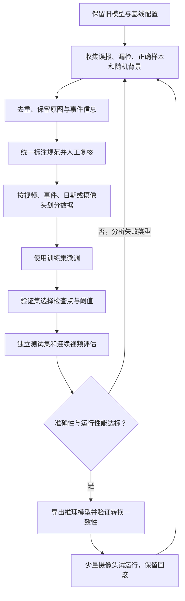

# 目标检测误报与漏检的数据迭代流程

学习日期：2026-11-05。类型：通用计算机视觉方法与视频分析项目实践。

关联阅读：[ByteTrack 如何服务异常停车规则](ByteTrack如何服务异常停车规则.md)、[流水线为什么要并发](../Python并发/流水线为什么要并发.md)。

本文整理现场检测不适应时的数据收集、标注、微调、评估和部署流程。项目部分仅保留可复用的方法与源码相对位置，不包含现场图片、私人服务器信息、模型权重或完整业务源码。以下建议尚未通过本项目的训练实验验证。

## 1. 为什么已有模型到了现场会出错

模型依据训练中见过的外观规律做判断。摄像头角度、目标距离、夜间成像、车灯、天气或视频压缩发生变化，实际输入就可能偏离原训练分布，通常称为域偏移。

- **误报 / 假阳性 FP**：没有摩托车，却把栏杆或杂物检测为摩托车。
- **漏检 / 假阴性 FN**：确实存在行人，却没有正确检出。
- **类别混淆**：框的位置基本正确，但类别判断错。
- **业务误告警**：目标识别正确，但它位于业务不关心的区域，仍然触发告警。

“无告警”也不能直接等同于“模型漏检”：正确检测结果还可能在类别映射、连续命中规则或上报环节被过滤。

| 观察到的问题 | 优先检查 | 后续办法 |
|---|---|---|
| 固定背景持续被检测为人或摩托车 | 原始画面、类别和置信度 | 收集困难负样本，标注后微调 |
| 远处或夜间真实目标没有框 | 输入像素、清晰度、现场数据覆盖 | 补充漏检样本，检查成像与分辨率 |
| 有正确框但无告警 | 类别映射、规则条件、处理链路 | 调整对应配置或逻辑，再做回归验证 |
| 道路外真实摩托车被告警 | 告警区域定义 | 道路 ROI 或道路分割 |
| 高清原图能检出，在线视频检不出 | 两条路径的缩放、抽帧与负载 | 按线上输入处理重新评估 |

真实的道路外摩托车仍应标为摩托车。不要为了抑制业务告警，故意把真实目标标成背景。

## 2. 一轮完整迭代

训练集用于学习，验证集用于选择模型和参数，测试集用于独立验收。测试数据参与训练后，就不能继续作为独立测试依据，必须更新测试划分和版本。

## 3. 数据收集：不能只保存告警

### 3.1 四类数据都需要

| 数据 | 例子 | 目的 |
|---|---|---|
| 误报样本 | 杂物、树影、护栏、反光被识别为目标 | 学会区分困难背景 |
| 漏检样本 | 夜间行人、远处摩托车、遮挡目标 | 补充尚未掌握的目标外观 |
| 正确目标 | 多种角度、距离和光照下的真实目标 | 保持已有检测能力 |
| 普通背景 | 正常道路、车灯、雨水、空场景 | 检查和抑制背景误报 |

告警图片只覆盖系统已经发现的部分情况。漏检通常没有告警记录，因此必须另设人工巡查和随机抽样。

推荐组合：

1. 留存误报发生前后的短视频与原始帧。
2. 人工检查部分未告警视频，登记真实目标及出现时间。
3. 按摄像头、日期、白天与夜间等条件随机取样，避免只看异常案例。
4. 从原视频中选择目标距离、角度、遮挡或光照有明显变化的代表帧。

连续一千帧相同背景，信息量可能小于来自多个摄像头的几十个不同错误。应按事件整理并做近重复检查，避免相同背景占据过多训练权重。

### 3.2 保留可追溯信息

每个样本建议记录：

- 原始视频标识、摄像头标识、时间及帧号。
- 问题类型：误报、漏检、类别错误、业务范围错误。
- 白天／夜间、天气、目标大小、遮挡等属性。
- 旧模型版本、推理配置及预测结果。
- 人工复核结论与标注版本。

训练优先使用未画框的原图。画过框、文字或置信度的图片适合复盘，不宜直接混入普通训练图片。若只有带框截图，应尽量找回对应原始视频；简单涂掉框线也可能引入人为伪影。

### 3.3 夜间数据要是真实的夜间数据

真实夜间不仅是亮度低，还可能有传感器噪声、运动模糊、车灯过曝、红外成像和黑白画面。

把白天图片调暗可以作为训练增强，但不能替代真实夜间数据。若原图已经严重过曝、模糊，或目标只有极少像素，需要同时改进成像和输入处理，不能保证靠训练恢复不存在的细节。

## 4. 标注规范与质量控制

### 4.1 先写清类别边界

批量标注前，先确定：

- 摩托车、电动车、自行车如何区分。
- 骑车的人是否单独标注，以及人与车辆的框如何处理。
- 行人与其他“人”类别的语义边界。
- 遮挡时标可见部分还是估计完整范围。
- 模糊到无法判断类别的目标如何处理。
- 图片内所有待检测类别是否需要完整标注。

不确定目标不能随意标成背景。应交由复核，或按训练框架支持的忽略机制处理；如果框架不支持忽略，需要谨慎筛选该样本。

### 4.2 误报样本如何标

例子：垃圾桶被检测为摩托车。

- 如果垃圾桶不属于当前检测类别，不标摩托车框。
- 图片内若有真实行人和汽车，它们仍需正确标注。
- 只有整张图片没有任何待检测类别，才是完整背景负样本。
- 通常无需额外创建“非摩托车”类别。是否新增干扰物类别，应看业务价值及类别体系。

**负样本不等于可以漏标。** 若训练体系识别多个类别，只删除错误摩托车框，却遗漏画面里的真实汽车，会把这些真实目标错误地作为背景参与学习。

### 4.3 自动标注只能提供草稿

可以先用现有模型预标注，再人工：

1. 删除错误框。
2. 补齐漏框。
3. 修正类别。
4. 调整框位置。
5. 检查遮挡、小目标和夜间样本。

LabelMe 可用于图片框标注；CVAT 提供视频标注与人工复核流程。需要有单独的质量检查，不能把模型预测直接当成真值，否则会将原有错误重新教给模型。

## 5. 数据划分与版本管理

例如可以按约 70%／15%／15% 划分训练、验证和测试，但比例不是验收标准。视频场景更重要的是防止泄漏。

错误例子：

> 同一段视频的第 100 帧放训练集，第 101 帧放测试集，两张图几乎相同，测试结果因此偏乐观。

建议按完整视频片段或独立事件分组，并根据目标设置：

| 测试分组 | 验证的问题 |
|---|---|
| 同摄像头、不同日期 | 已部署摄像头能否持续稳定运行 |
| 未参与训练的摄像头 | 新场景泛化能力如何 |
| 夜间、雨天、强反光 | 困难条件是否改善 |
| 小目标、遮挡目标 | 是否真正解决指定漏检 |
| 旧场景回归集 | 新模型是否损伤原有能力 |

先分组划分，再对训练集增强。原图及其增强版本不能分到不同集合。

固定记录数据清单、标签版本、划分清单、训练配置、随机种子、代码及依赖版本、模型与导出配置。一个批次内样本越多，不代表独立事件越多；应同时统计摄像头数、视频时长和独立事件数。

## 6. 微调：首轮先验证数据的价值

### 6.1 从哪里开始训练

优先寻找现有模型对应的可训练检查点、模型结构、训练配置和原训练数据。TensorRT engine 是推理产物，常规训练需要原训练框架支持的可训练权重和模型定义。

如果无法取得原训练模型，可以从合适的预训练模型建立新基线，但这属于重新建立训练与部署链路，不能视为直接对现有 engine 继续训练。换模型还需检查导出格式、类别表及项目后处理兼容性。

### 6.2 首轮训练数据怎么组成

建议使用：

> 原有代表性数据 ＋ 新增困难负样本 ＋ 新增漏检目标 ＋ 普通背景。

不要只用误报图片训练，否则可能降低误报的同时明显增加漏检。也不要只训练夜间、完全舍弃白天回归验证。

没有适用于所有现场的固定样本比例和最低图片数量。先按独立场景和事件建立小批次，确认标注质量与学习趋势，再持续补足薄弱分组。

### 6.3 训练调整顺序

1. 尽量保持原模型结构与输入处理，先建立可复现基线。
2. 在同类设置下加入审核后的现场数据，观察效果。
3. 根据失败分组调整采样，避免夜间、小目标等稀少情况被淹没。
4. 适量加入曝光、噪声、模糊、压缩等符合现场的增强。
5. 若小目标仍是瓶颈，再评估更高有效分辨率、局部裁剪或其他方法。
6. 数据与处理已合理而效果仍不足，再比较更大模型、二级分类器或分场景方案。

训练轮数、学习率和冻结层数应依据原配置、验证曲线及训练稳定性选择。不能只看训练损失下降；也不应仅因为换了新模型，就同时大改全部训练参数。

每轮尽量只改变一组因素，记录结果。更高分辨率、更大模型和额外识别阶段都可能降低可处理的视频路数。

## 7. 评估：图片检测和最终告警都要看

### 7.1 图片层指标

- 精确率 Precision = TP / (TP + FP)：预测为目标的结果有多少正确。
- 召回率 Recall = TP / (TP + FN)：真实目标有多少被检出。
- mAP、混淆矩阵：按约定匹配规则评估框与类别质量。
- 各类别、白天／夜间、小目标等分组指标。

提高置信度阈值通常会减少部分误报，也会丢掉低分的真实目标。置信度分数不应直接解释为精确的正确概率。阈值通过验证集选择，并用独立测试集确认。

### 7.2 视频业务指标

| 指标 | 实际含义 |
|---|---|
| 每摄像头每小时误报数 | 人员实际受到多少无效告警 |
| 真实事件检出率 | 人工确认的独立事件中，多少触发正确告警 |
| 首次告警延迟 | 目标满足业务条件到首次告警的时长 |
| 重复告警数 | 同一事件是否反复打扰人员 |
| 实际处理 FPS 与延迟 | 是否满足实时性要求 |
| CPU、GPU、内存和显存 | 当前路数是否仍可稳定运行 |

事件需要预先定义匹配区域、时间范围和去重规则。同一事件连续一百帧正确，不等于一百次独立事件成功。

### 7.3 两种测试材料都保留

- **困难案例集**：集中检查已知误报、漏检和边缘情况。
- **有代表性的连续视频**：估计正常运行中的误报负担和真实事件表现。

困难案例集通常有意提高错误场景比例，不能直接推算真实线上误报率。

旧模型和新模型应使用相同的数据、输入处理和业务规则比较。如果同时调整阈值，需要明确这是另一组实验，避免无法区分模型改进与规则变化。

## 8. 导出、部署与回滚

常见路线为：

> 可训练模型 → 导出交换格式或直接导出引擎 → TensorRT engine → 项目推理 → 跟踪和业务规则 → 告警。

具体是否经过 ONNX，要看原训练与导出工具，不能默认项目已具备整条链路。

上线前检查：

1. 类别 ID、名称和顺序与规则一致。
2. 输入尺寸、RGB/BGR、归一化和数据布局一致。
3. 输出结构、NMS 和置信度筛选与项目后处理兼容。
4. 检查导出端的阈值，避免过早丢掉低分候选框。
5. 用同一批样本比较训练框架与实际 engine 的预测结果。
6. 回放连续视频，验证跟踪、告警和多路性能。
7. 记录目标 GPU、TensorRT 等构建环境，并核对引擎兼容性。
8. 先少量摄像头试运行，保留旧模型及配套配置。

仅验证模型能加载还不够。需要确认导出没有引入不可接受的准确性变化，并且系统能承受实际负载。

## 9. 工程实践与学术方法

工程实践通常先建设稳定的数据与评估流程，衡量误报、漏报、延迟、处理成本和回滚能力。

进一步研究的方法包括：

| 方法 | 通俗解释 | 使用前提与注意事项 |
|---|---|---|
| 主动学习 | 优先挑值得标注的样本 | 兼顾不确定样本、多样性及随机样本，不能只挑低分框 |
| 半监督学习 | 借助未标注数据辅助训练 | 伪标签质量需要控制，防止强化已有错误 |
| 域适应 | 改善昼夜或摄像头间的分布差异 | 需要独立目标场景测试，不能只看源数据指标 |

这些方法并不替代可靠的人工作业规范与测试集。对于已有现场数据、类别相对明确的项目，先做监督微调和严格评估通常更便于定位收益。

## 10. 视频检测项目中的落地检查

以下是阅读项目源码后确认的事实；类别语义和训练来源仍需查原训练资料。

| 已确认的事实 | 对优化流程的影响 | 源码相对位置 |
|---|---|---|
| 模型配置包含 car、motor、pedestrian、people、truck | 需要先明确 pedestrian 与 people 的边界，不能未经确认直接合并 | `weights/camera_sys/road_obj_det/infer_cfg.yaml:1` |
| 行人规则只配置 pedestrian | 有框但不告警，可能涉及类别映射，应先排查 | `project/camera_sys/configs/pipeline.yaml:108` |
| 在线拉流配置先缩放到 768×432，检测预处理再到 768×768 | 高清图片离线测试与在线输入不同；需要增加与线上一致的评估 | `project/camera_sys/configs/pipeline.yaml:60`；`project/camera_sys/configs/camera_sys_road_obj_det.yaml:5` |
| 图片离线脚本直接将读到的图片交给检测器 | 它可用于查看预测，但不能直接代替在线链路测试 | `project/camera_sys/tools/infer_local_images.py:75` |
| 现有视频预标注脚本只保存命中指定类别的帧 | 无法覆盖模型完全漏检的样本，需要独立人工抽样 | `project/camera_sys/tools/video_to_labelme/video_to_labelme.py:133` |
| 图片推理脚本输出框、类别和置信度 | 未与人工真值匹配，不能直接计算准确率 | `project/camera_sys/tools/infer_local_images.py:75` |
| 当前检测配置阈值 0.4，行人规则 5 中 4，摩托车规则 10 中 6 | 可抑制部分偶发误报，无法纠正持续出现的类别错误 | `project/camera_sys/configs/camera_sys_road_obj_det.yaml:17`；`project/camera_sys/configs/pipeline.yaml:108` |
| 命中窗口按每路是否有指定目标统计，不要求同一个跟踪 ID | 连续命中不等于同一目标被持续确认 | `project/camera_sys/core/rule/pedestrian.py:69` |
| 当前模型目录看到 engine 和推理配置，没有看到对应训练检查点 | 先找训练资产；这不代表其他目录或外部存储一定没有权重 | `weights/camera_sys/road_obj_det/` |

建议第一轮执行顺序：

1. 找齐原模型、类别定义、训练数据和配置。
2. 审核已有误报图片，找回原图。
3. 补充夜间真实目标、完全漏检和随机正常样本。
4. 统一标注并独立复核，按事件或视频划分数据。
5. 固定旧模型基线和独立测试视频。
6. 保持原架构微调，先评估数据带来的收益。
7. 导出后回放完整流程，同时比较告警与多路性能。
8. 记录失败类型，开始下一轮数据迭代。

尚待确认：原模型的具体架构版本、原训练数据来源、可训练检查点位置、people 的准确业务语义。推理配置不能完整回答这些问题。

## 11. 自查与小练习

自查：

- 为什么只收集告警图片无法解决所有漏检？
- 为什么误报图片里真实存在的其他类别仍然需要标注？
- 为什么不能随机把同一视频的相邻帧分到训练与测试？
- 为什么阈值提高后误报少了，还不能证明模型变好了？
- 为什么图片准确率改善后仍要测试连续视频？
- 为什么道路外真实目标应该通过业务区域处理？

练习：选一段白天视频、一段夜间视频和几个误报事件，制作一张样本登记表，先记录摄像头、时间、问题类型、原图位置和人工结论。将同一事件的所有帧分配到同一集合，说明每个集合用于什么。先完成数据设计，再决定训练参数。

## 12. 推荐资料

1. [Ultralytics：计算机视觉项目完整步骤](https://docs.ultralytics.com/guides/steps-of-a-cv-project/)  
   学习从需求、数据和标注到训练、评估及部署的整体流程。
2. [Ultralytics：训练数据与训练结果改进建议](https://docs.ultralytics.com/yolov5/tutorials/tips-for-best-training-results/)  
   重点看数据多样性、完整标注、背景样本和集合隔离。该页针对 YOLOv5，命令与超参数不能直接套用到未知版本模型。
3. [Ultralytics：自定义数据微调](https://docs.ultralytics.com/guides/finetuning-guide/)  
   理解预训练权重和微调；实际 API、类别迁移行为及参数应以选定训练版本为准。
4. [Ultralytics：目标检测指标](https://docs.ultralytics.com/guides/yolo-performance-metrics)  
   学习 Precision、Recall、mAP、PR 曲线与混淆矩阵。
5. [CVAT：人工标注质量复核](https://docs.cvat.ai/docs/qa-analytics/manual-qa/)  
   学习把自动预测作为草稿、再进行人工检查的工作方式。
6. [NVIDIA：TensorRT 如何工作](https://docs.nvidia.com/deeplearning/tensorrt/latest/architecture/how-trt-works.html)  
   理解训练模型与推理引擎的分工。
7. [NVIDIA：TensorRT engine 兼容性](https://docs.nvidia.com/deeplearning/tensorrt/latest/inference-library/engine-compatibility.html)  
   部署时核对硬件和版本兼容条件。
8. [综述：Unsupervised Domain Adaptation of Object Detectors](https://arxiv.org/abs/2105.13502)  
   在基础数据流程稳定后，进一步了解跨场景目标检测的研究方法。

推荐学习顺序：先看 1、2、4，完成一小批人工标注与基线评估，再看 3、5；准备部署时看 6、7，研究跨场景方法时看 8。
